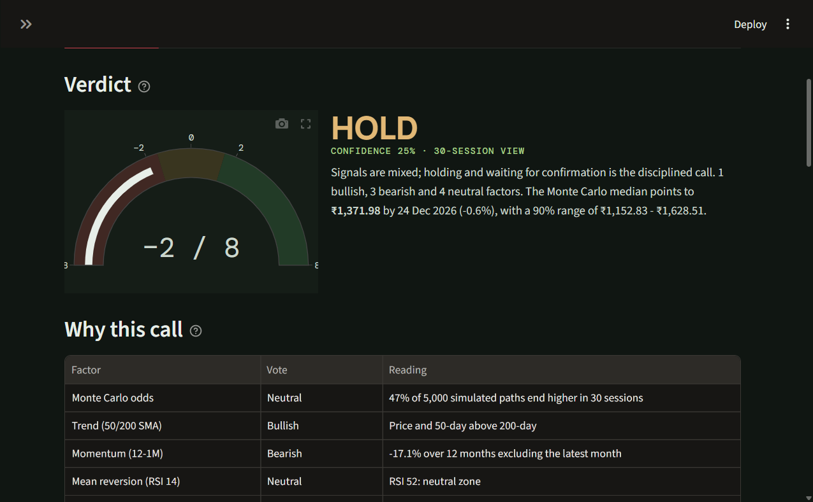
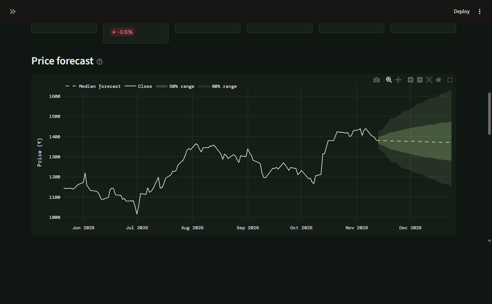
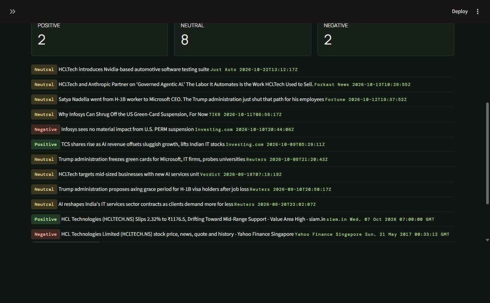
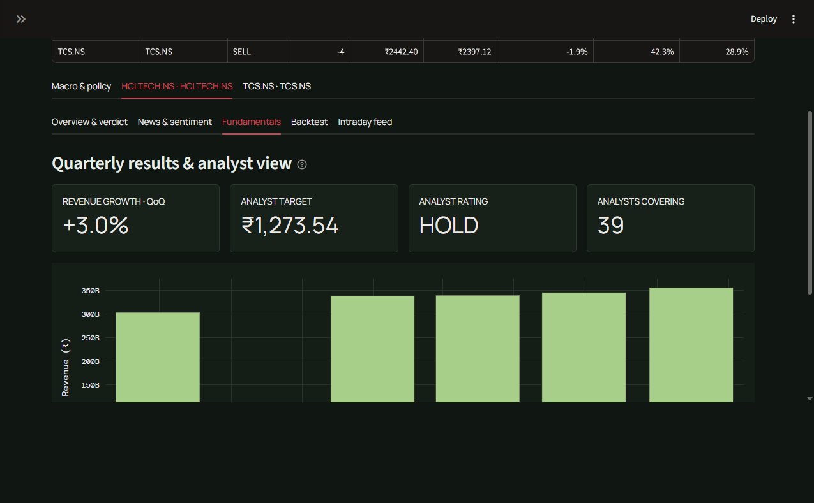
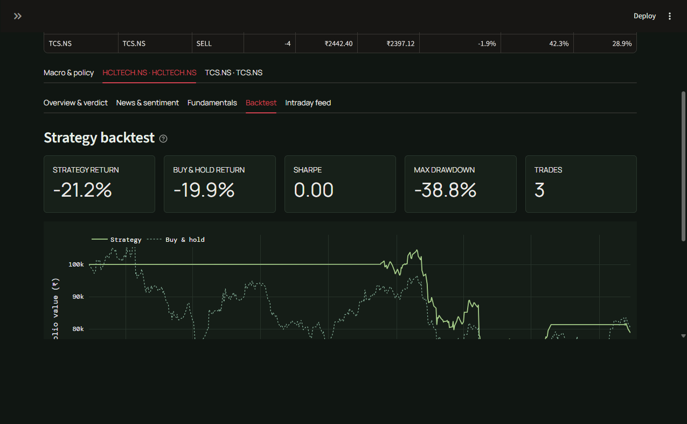
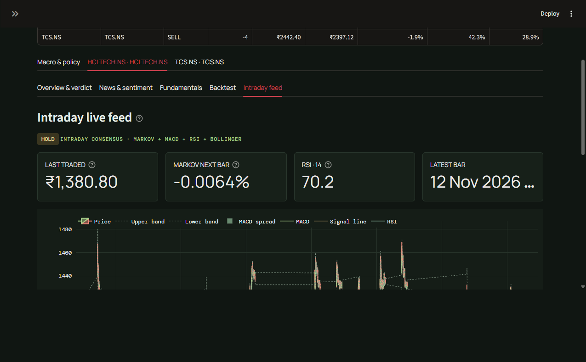
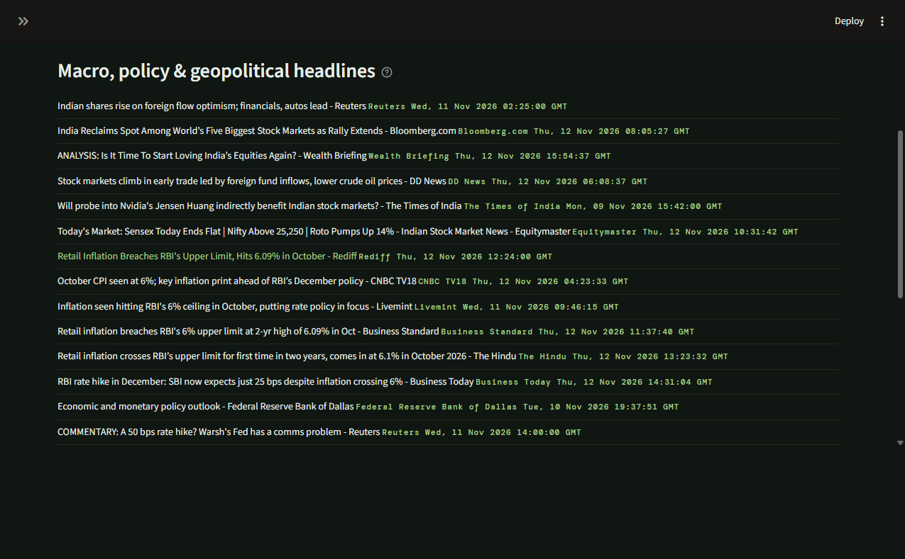
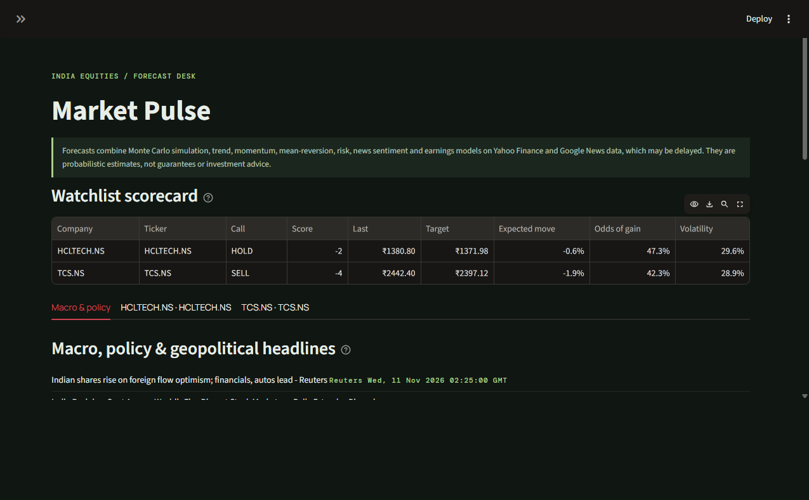

# Market Pulse

**A Streamlit-based trading research desk for NSE/BSE equities** — Monte Carlo price forecasting, multi-factor BUY/SELL/HOLD signals, news sentiment, quarterly fundamentals, a rule-based strategy backtest, and a Kafka-streamed one-minute intraday feed, all running as a multi-container Docker application.

Yahoo Finance supplies daily and one-minute OHLCV bars. Apache Kafka carries ticker subscriptions and bar updates between a lightweight collector service and a storage consumer. Each ticker's intraday bars are persisted independently in its own SQLite file under `data/`.

> **Disclaimer:** This project combines standard, publicly documented quantitative techniques (Monte Carlo simulation, moving-average/RSI systems, lexicon-based sentiment, mean-variance risk statistics). It is a research/engineering showcase, **not investment advice**, and is not suitable for live trading or execution.

---

## Table of contents

- [Screenshots](#screenshots)
- [Key features](#key-features)
- [Architecture](#architecture)
- [Tech stack](#tech-stack)
- [Project layout](#project-layout)
- [Quickstart (Docker)](#quickstart-docker)
- [Using the app](#using-the-app)
- [What each company's dashboard shows](#what-each-companys-dashboard-shows)
- [Data and signal limits](#data-and-signal-limits)
- [Local development & tests](#local-development--tests)
- [Configuration](#configuration)

---

## Screenshots

The screenshots below were captured from a live local run (`docker compose up --build`) with the sample ticker **HCLTECH.NS** (HCL Technologies, NSE) added to the dashboard, plus a second ticker **TCS.NS** to illustrate the multi-company watchlist.

### Verdict & multi-factor "why this call" breakdown

The gauge shows the net vote across 7–8 independent factors (Monte Carlo odds, trend, momentum, RSI, MACD, risk-adjusted return, news sentiment, earnings trend), with a plain-English rationale and a confidence score.



### Monte Carlo price forecast

A 5,000-path Monte Carlo simulation (EWMA/RiskMetrics volatility, trailing drift) projects the price distribution over the selected horizon, with 50% and 90% uncertainty bands against the trailing two years of daily closes.



### News & sentiment

Recent headlines from Yahoo Finance and Google News, each scored Positive/Neutral/Negative with VADER sentiment; the aggregate tone feeds into the verdict above.



### Fundamentals

Latest quarterly revenue trend alongside analyst target price, rating, and coverage count.



### Strategy backtest

A rule-based 50/200-day SMA + RSI strategy simulated over the available daily history, benchmarked against buy & hold.



### Live intraday feed (Kafka-streamed)

One-minute bars streamed end-to-end through Kafka (collector → consumer → SQLite → UI), rendered with Bollinger Bands, MACD and RSI, refreshing automatically every 60 seconds.



### Macro & policy headlines

A standalone tab aggregating broad market, monetary-policy and geopolitical headlines, independent of any single company.



### Multi-company watchlist scorecard

Adding a second ticker (TCS.NS) automatically surfaces a side-by-side scorecard comparing calls, targets, expected moves, odds of gain and volatility across the whole watchlist.



---

## Key features

- **Multi-factor verdict engine** — combines Monte Carlo simulation odds, 50/200-day trend, 12-1 month momentum, RSI mean reversion, MACD crossover, 1-year Sharpe ratio, news sentiment, and quarterly earnings trend into a single BUY/SELL/HOLD call with a confidence score.
- **Monte Carlo forecasting** — 5,000 simulated price paths per ticker using EWMA (RiskMetrics λ = 0.94) volatility and trailing drift, producing median forecasts and 50%/90% uncertainty bands.
- **Live intraday streaming** — a Kafka producer/consumer pair polls Yahoo Finance for new one-minute bars and republishes them; a Streamlit fragment re-renders the chart every 60 seconds without a full page reload.
- **Per-ticker durable storage** — each ticker's intraday history is stored in its own SQLite file (`data/<TICKER>.sqlite3`), so restarting the stack does not lose historical bars.
- **News sentiment** — headlines from Yahoo Finance and Google News RSS are scored with VADER and rolled into both the per-headline badges and the verdict factor table.
- **Fundamentals** — quarterly revenue growth, analyst target price, rating, and analyst coverage count pulled from Yahoo Finance.
- **Strategy backtesting** — a 50/200-day SMA crossover + RSI extremes strategy run via the `backtesting` library, reporting return, Sharpe, max drawdown and trade count against buy & hold.
- **Watchlist scorecard** — adding two or more companies automatically surfaces a comparison table across all of them.
- **Macro tab** — independent market/policy/geopolitical news feed not tied to any single ticker.
- **Fully containerized** — one `docker compose up --build` starts Zookeeper, Kafka, the collector, the storage consumer and the Streamlit UI together.

## Architecture

```
┌──────────────┐  ticker symbol   ┌───────────────┐
│  Streamlit   │ ───────────────▶ │ ticker-        │
│  UI (app)    │                  │ subscriptions  │  Kafka topic
│              │ ◀─────────────── │ (collector     │
│ reads bars   │   1-min bars     │  subscribes)   │
│ from SQLite  │                  └───────┬────────┘
└──────┬───────┘                          │ yfinance poll (60s)
       │                                  ▼
       │                         ┌─────────────────┐
       │  data/<TICKER>.sqlite3  │   collector      │
       └────────────◀────────────│ (market_collector│
                market-bars topic│      .py)        │
                                 └─────────┬────────┘
                                           │ market-bars topic
                                           ▼
                                 ┌─────────────────┐
                                 │ storage consumer │
                                 │ (market_consumer  │
                                 │      .py)        │
                                 └─────────┬────────┘
                                           ▼
                                   data/<TICKER>.sqlite3
```

```
config.py           shared settings (Kafka topics, data dir, macro news topics)
sources/             external data: prices (yfinance + sqlite), news (Yahoo/Google News RSS), fundamentals
analytics/           pure, testable logic: indicators, intraday signals, Monte Carlo forecast, sentiment, backtest
streaming/           Kafka collector/consumer loops used by the two background services
ui/                  Streamlit rendering: theme/CSS, Plotly chart builders, the dashboard itself
streamlit_app.py     entrypoint (page config + ui.dashboard.run())
market_collector.py  entrypoint for the `collector` service (docker-compose)
market_consumer.py   entrypoint for the `storage` service (docker-compose)
data/                runtime SQLite storage for intraday bars (DATA_DIR), not Python source
```

### Services (`docker-compose.yml`)

| Service     | Image / build          | Role                                                                 |
|-------------|-------------------------|-----------------------------------------------------------------------|
| `zookeeper` | `confluentinc/cp-zookeeper:7.8.0` | Coordination service required by this Kafka version                  |
| `kafka`     | `confluentinc/cp-kafka:7.8.0`     | Message broker carrying `ticker-subscriptions` and `market-bars` topics |
| `collector` | built from `Dockerfile` | Polls Yahoo Finance every 60s for subscribed tickers, publishes new bars to Kafka |
| `storage`   | built from `Dockerfile` | Consumes bars from Kafka and persists them to per-ticker SQLite files |
| `app`       | built from `Dockerfile` | The Streamlit UI (port `8501`), reads SQLite and produces ticker subscriptions |

## Tech stack

| Layer                 | Technology |
|------------------------|------------|
| UI / web app           | [Streamlit](https://streamlit.io/) |
| Charts                 | [Plotly](https://plotly.com/python/) |
| Market data             | [yfinance](https://github.com/ranaroussi/yfinance) (Yahoo Finance) |
| News                   | Yahoo Finance + Google News RSS (via `feedparser`) |
| Sentiment analysis      | [VADER](https://github.com/cjhutto/vaderSentiment) |
| Backtesting            | [backtesting.py](https://kernc.github.io/backtesting.py/) |
| Streaming              | [Apache Kafka](https://kafka.apache.org/) via `confluent-kafka` |
| Data analysis           | pandas, NumPy |
| Storage                | SQLite (one file per ticker) |
| Containerization        | Docker, Docker Compose |
| Testing                | pytest |

## Project layout

```
hft_app/
├── analytics/              # Pure, unit-tested quant logic
│   ├── backtest.py          # 50/200 SMA + RSI strategy backtest
│   ├── forecast.py          # Monte Carlo forecast + multi-factor voting
│   ├── indicators.py        # RSI, MACD
│   ├── sentiment.py         # VADER headline scoring
│   └── signals.py           # Intraday Markov-chain + MACD/RSI/Bollinger signal
├── sources/                 # External data access
│   ├── prices.py             # yfinance OHLCV download + SQLite read/write
│   ├── news.py                # Yahoo Finance + Google News RSS headlines
│   └── fundamentals.py        # Quarterly revenue + analyst data
├── streaming/                # Kafka producer/consumer loops
│   ├── collector.py           # Polls yfinance, publishes bars to Kafka
│   └── consumer.py            # Consumes bars, writes to SQLite
├── ui/                       # Streamlit rendering
│   ├── dashboard.py            # Main dashboard logic/layout
│   ├── charts.py                # Plotly chart builders
│   └── theme.py                  # CSS theme + tooltip copy
├── data/                     # Runtime SQLite storage (gitignored, one file per ticker)
├── screenshots/              # README screenshots
├── config.py                 # Shared settings (Kafka topics, data dir, macro topics)
├── streamlit_app.py           # App entrypoint
├── market_collector.py         # `collector` service entrypoint
├── market_consumer.py           # `storage` service entrypoint
├── Dockerfile
├── docker-compose.yml
├── requirements.txt
├── pytest.ini
├── test_analytics.py
└── test_market_store.py
```

## Quickstart (Docker)

**Prerequisites:** Docker Desktop (or Docker Engine + Compose plugin).

```powershell
cd hft_app
docker compose up --build
```

This builds the app image and starts five containers: `zookeeper`, `kafka`, `collector`, `storage`, and `app`. Wait until Kafka reports healthy (compose uses health checks and `depends_on: condition: service_healthy` to sequence startup).

Open **http://localhost:8501** in your browser.

Stop the containers with `Ctrl+C`, or run:

```powershell
docker compose down
```

The named `zookeeper-data`, `zookeeper-log`, and `kafka-data` volumes plus the host-mounted `data/` folder preserve data across restarts. `docker compose down -v` removes the Kafka/Zookeeper volumes but does **not** remove `data/`.

## Using the app

1. In the sidebar, type a company name or a Yahoo Finance ticker (for example `HCLTECH`, `TCS`, or `Tata Motors`) and click **Search Yahoo Finance**.
2. Pick the matching NSE/BSE symbol from the dropdown and click **Add to dashboard**. This both renders the forecast tab for that company and publishes a Kafka subscription so the collector starts streaming its one-minute bars.
3. Add as many companies as you like — each gets its own tab with five sub-tabs (Overview & verdict, News & sentiment, Fundamentals, Backtest, Intraday feed), plus a side-by-side scorecard once there are two or more.
4. Adjust the **Forecast horizon** slider (5–90 trading sessions) to change how far ahead the Monte Carlo simulation projects prices.
5. A standalone **Macro & policy** tab is always available and does not require adding a ticker.

Every chart, metric, and section title has an **(i)** tooltip explaining exactly what it measures.

## What each company's dashboard shows

- **Overview & verdict** — a BUY/SELL/HOLD call from a multi-factor vote (Monte Carlo odds, 50/200-day trend, 12-1 month momentum, RSI mean reversion, MACD crossover, 1-year Sharpe, plus news sentiment and quarterly earnings trend when available), the Monte Carlo price forecast with uncertainty bands, and trend/momentum/drawdown/return-distribution charts.
- **News & sentiment** — recent headlines from Yahoo Finance and Google News, each tagged positive/neutral/negative; the average tone feeds the verdict.
- **Fundamentals** — latest quarterly revenue growth, analyst price target, rating and coverage count.
- **Backtest** — a rule-based 50/200-day SMA + RSI strategy simulated over the available daily history, benchmarked against buy & hold (return, Sharpe, max drawdown, trade count).
- **Intraday feed** — one-minute bars streamed through Kafka with Bollinger Bands, MACD and RSI, refreshing every 60 seconds.

A standalone **Macro & policy** tab aggregates broad market, policy and geopolitical headlines, independent of any single company.

These combine standard, publicly documented quantitative techniques (Monte Carlo simulation, moving-average and RSI systems, lexicon-based sentiment, mean-variance risk stats) — not any specific trading firm's proprietary model — and are not investment advice.

## Data and signal limits

yfinance is an unofficial data interface. Its one-minute bars may be delayed, rate-limited, unavailable for some symbols, or revised; this is **not** an exchange-live tick feed and is **not** suitable for HFT execution. Historical one-minute data is limited to a recent window by Yahoo Finance. News is aggregated from Yahoo Finance and public Google News RSS search results and is not deduplicated or fact-checked.

The intraday signal combines a smoothed three-state Markov expected return with MACD, 14-period RSI, and 20-period Bollinger Bands. BUY/SELL require at least two aligned votes; otherwise the result is HOLD. It is an illustrative heuristic, not investment advice or a backtested strategy.

## Local development & tests

```powershell
python -m pip install -r requirements.txt
python -m pytest -q
```

Tests cover the pure analytics layer (`test_analytics.py`) and the SQLite-backed market data store (`test_market_store.py`), independent of Kafka or a running Streamlit session.

## Configuration

All configuration lives in [`config.py`](config.py) and is overridable via environment variables (already wired up in `docker-compose.yml`):

| Variable                   | Default           | Purpose                                      |
|-----------------------------|--------------------|-----------------------------------------------|
| `DATA_DIR`                  | `data`             | Directory for per-ticker SQLite files          |
| `KAFKA_BOOTSTRAP_SERVERS`    | `localhost:9092`   | Kafka broker address                           |
| `SUBSCRIPTION_TOPIC`         | `ticker-subscriptions` | Topic the UI publishes new ticker subscriptions to |
| `MARKET_TOPIC`               | `market-bars`      | Topic the collector publishes bars to and the storage consumer reads from |
| `POLL_SECONDS`               | `60`               | Collector polling interval for new intraday bars |
